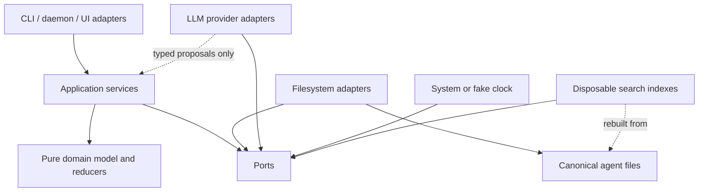
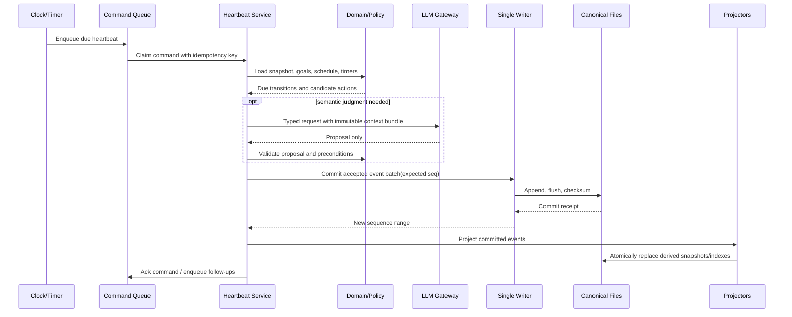
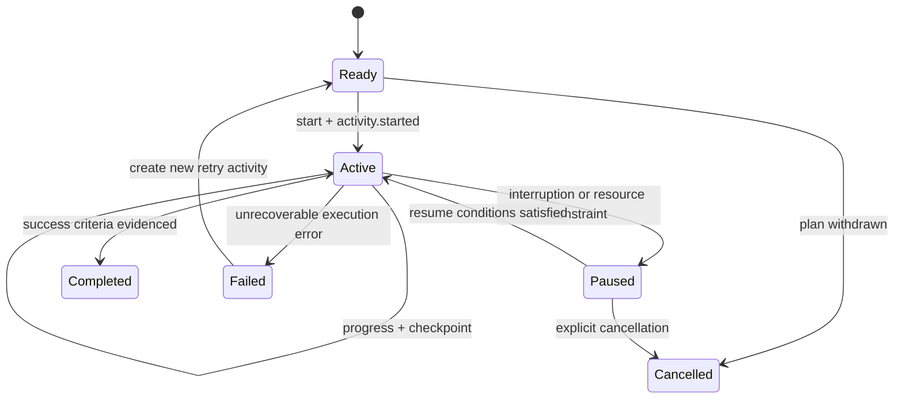
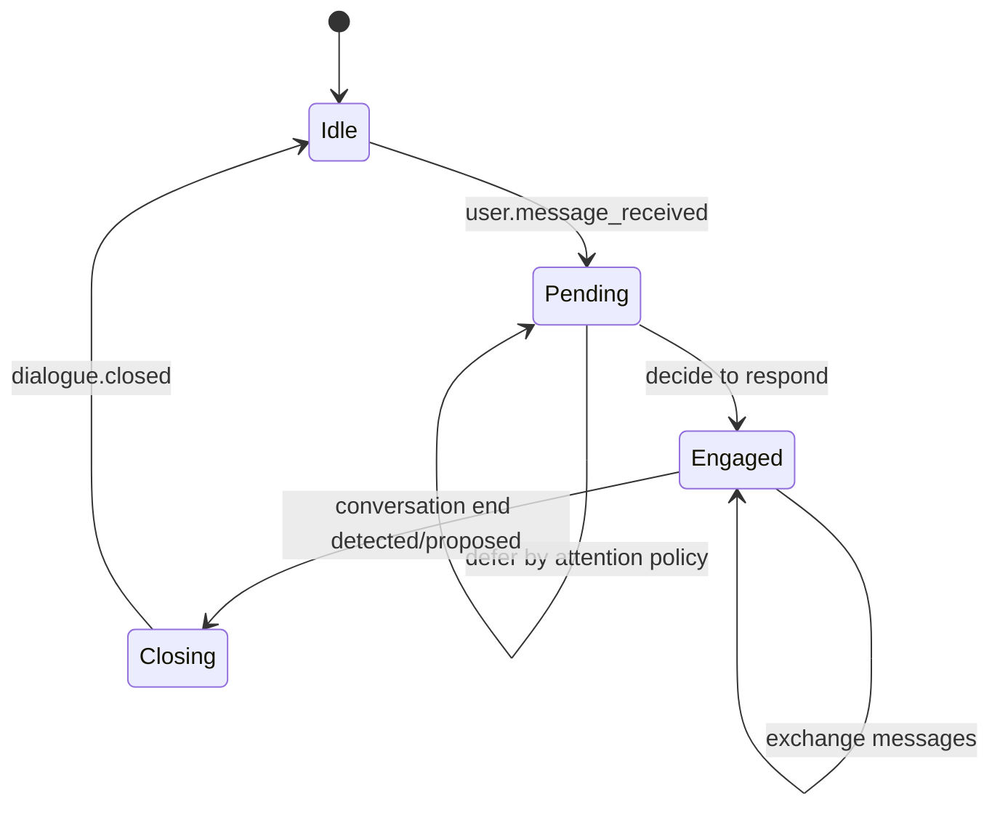

# Artificial Life Agent Architecture

> Status: V1 Persistent Life Agent implemented with deterministic/mock provider  
> Updated: 2026-08-18  
> Default persona: 轻小说作家  
> Scope: architecture baseline plus the implemented V1 lifecycle, file-backed memory, retrieval, contexts, and local Web UI adapter. Production LLM adapters, distributed execution, and high-concurrency writers remain out of scope.

## 1. Purpose and scope

This document defines the maintainable architecture for an artificial-life agent that continues to live, plan, act, remember, and make decisions even when no user message arrives. The initial persona is a light-novel writer, but persona-specific content is data and policy, not a reason to couple the runtime to one character.

The target loop is:

```text
Time advance
  -> Heartbeat
  -> Schedule / Goal
  -> Activity
  -> State
  -> Raw Timeline
  -> Memory Summary
  -> Retrieval
  -> Context Builder
  -> Behavior Decision
```

This is a logical loop, not a requirement to call an LLM on every heartbeat. Most heartbeats should finish using deterministic code and persisted state only.

### 1.1 Goals

- Maintain a continuous, inspectable timeline without depending on user messages.
- Separate planned work from facts that actually occurred.
- Store all durable memory in human-inspectable files.
- Preserve source provenance through every memory-summary level.
- Retrieve memory coarse-to-fine and verify final claims against source facts.
- Let dialogue interrupt an activity safely, then resume from a checkpoint.
- Keep clocks, timers, state transitions, scheduling mechanics, validation, and random sampling deterministic where possible.
- Restrict the LLM to semantic and generative work; treat its output as a proposal.
- Make recovery, replay, migration, and tests first-class concerns.

### 1.2 Non-goals for this design phase

- Implementing production business behavior, prompts, a production UI, or a daemon.
- Choosing a hosted LLM vendor permanently.
- Modeling a physically complete world or human cognition.
- Using vector search as the canonical memory store.
- Allowing generated prose to become a historical fact without code validation and commit.

## 2. Repository assessment and implementation status (2026-08-11)

The repository was read recursively before implementation. It started with only
`agents.md` and this design document; there were no existing abstractions to
reuse. The following Phase 1 implementation is now present under `src/` and
`tests/`.

| Area | Current evidence | Reuse decision |
|---|---|---|
| Project policy | `agents.md` defines the persona and core invariants | Reuse as binding project policy |
| Application source | `src/artificial_life/` contains the deterministic runtime | Extend through ports/adapters in later phases |
| Entrypoint / runtime | Python API: `LifeRuntime`, `heartbeat`, and `run_due`; local HTTP UI in `webui.py` | Add a production daemon/deployment adapter later |
| LLM integration | Provider-neutral port plus deterministic `MockLLMProvider`; no network adapter | Add an optional production provider adapter |
| Persistence | Versioned JSON plan/state/timer files, checksummed dated JSONL L0 timeline, Raw Dialogue, Markdown memory trees | Keep indexes/cache derived if added later |
| Tests | Phase 1 and V1 lifecycle/memory/context/retrieval tests under `tests/` | Add contract/property/fault suites in later phases |
| Dependency manifest | `pyproject.toml`, standard-library runtime | Add dependencies only when a later phase requires them |
| Design documentation | This document plus implementation notes | Update with each architecture change |
| Git metadata | The inspected directory is not currently a Git worktree | Tooling must not assume Git is present |

Therefore, no pre-existing implementation module was reusable. Only the
policies in `agents.md` were reused. V1 deliberately uses a Mock provider and
seeded optional random-event hook; it does not make network LLM calls.

### 2.1 Phase 1 implementation map

| Requirement | Implementation |
|---|---|
| Clock / deterministic test clock | `src/artificial_life/clock.py` (`Clock`, `SystemClock`, `TestClock`) |
| Goals and plan validation | `src/artificial_life/models.py`, `plans.py` |
| Schedule versus fact separation | `ScheduleBlock`/`PlanStore` versus `RawTimeline` |
| Heartbeat and elapsed-time recovery | `src/artificial_life/runtime.py` (`LifeRuntime.heartbeat`, `run_due`) |
| Activity progress and completion | Rate-based heartbeat progress plus `record_activity_progress` |
| `reserved_free` state | `StateMode.RESERVED_FREE` and `state.transition` events |
| Raw Timeline | `src/artificial_life/timeline.py`, dated JSONL with sequence/checksum validation |
| Restart projection | Timeline replay on every `LifeRuntime` load, then atomic state/activity snapshots |
| Tests | `tests/test_phase1_runtime.py` (6 tests, including 10:32 completion and restart) |

## 3. Architectural principles and invariants

These are correctness rules, not preferences.

1. **Raw facts are append-only.** A committed timeline event is never edited or deleted. Corrections are new events that reference the corrected event.
2. **Plans are not facts.** Goals and schedule entries live outside the raw timeline. Only events such as “schedule entry created” or “activity started” are timeline facts.
3. **Files are durable memory.** Databases and indexes may accelerate access, but must be disposable and rebuildable from canonical files.
4. **Every summary is attributable.** L1/L2/L3 records contain source references and source-content hashes. A summary without valid sources is rejected.
5. **The LLM has no write capability to canonical history.** It returns typed proposals. Deterministic application code validates and commits accepted facts.
6. **One canonical writer per agent.** Heartbeats, user-input ingestion, and timer firing serialize through the same command queue and commit boundary.
7. **State snapshots are derived caches.** Timeline plus canonical plan/config files remain authoritative. A snapshot can be discarded and replayed.
8. **Activity and dialogue share Base Context only.** Their working contexts, budgets, checkpoints, and transcripts remain separate.
9. **A user message is input, not an automatic response command.** Response timing is chosen by deterministic interruption/attention policy plus behavior decision.
10. **Randomness is explicit.** Every stochastic decision records algorithm, seed, stream, and draw position so tests and replay can reproduce it.
11. **Time is explicit.** Persist UTC instants, configured IANA timezone, and logical tick/heartbeat identifiers. Never infer ordering from filenames alone.
12. **LLM calls are scarce side effects.** Cache safe semantic results, batch summaries, and skip calls when deterministic rules suffice.
13. **Schemas are versioned.** Readers reject unsupported future versions and migrations never rewrite raw history in place.
14. **Summaries never silently replace sources.** They are navigation and compression layers, not proof of an event.
15. **All decisions are auditable.** A behavior decision records candidate set, relevant evidence, policy version, and final selection.

## 4. System boundary and module boundaries

Use a ports-and-adapters structure: the domain and application layers do not import filesystem, clock, LLM SDK, or UI implementations.

### 4.1 Domain modules

| Module | Responsibility | Must not do |
|---|---|---|
| `domain.time` | Logical time, heartbeat IDs, time windows, catch-up calculations | Read the wall clock directly |
| `domain.goal` | Large/Medium/Small goal hierarchy, status and progress rules | Generate prose or write files |
| `domain.schedule` | Planned time blocks, revisions, conflicts, recurrence | Claim that planned work happened |
| `domain.activity` | Activity lifecycle, progress, checkpoints, interruption/resume | Manage dialogue transcript |
| `domain.dialogue` | Conversation session lifecycle, inbox state, response intent | Mutate active activity directly |
| `domain.state` | Agent/world state value objects and reducers | Become an independent source of historical truth |
| `domain.timeline` | Immutable fact events, correction/supersession links | Accept free-form unvalidated LLM facts |
| `domain.memory` | L0-L3 records, source references, provenance validation | Hide missing or invalid sources |
| `domain.context` | Context bundle types and separation rules | Call an LLM |
| `domain.behavior` | Candidate/action/decision models and policy contracts | Perform external side effects |
| `domain.randomness` | Seeded streams and draw receipts | Use process-global randomness |

### 4.2 Application services

| Service | Responsibility |
|---|---|
| `HeartbeatService` | Run one idempotent heartbeat transaction and schedule follow-up work |
| `GoalService` | Validate goal trees, progress, decomposition proposals, and status transitions |
| `ScheduleService` | Resolve due entries and plan revisions without inventing completion facts |
| `ActivityService` | Start, advance, pause, checkpoint, resume, complete, or fail an activity |
| `DialogueService` | Ingest messages, apply attention policy, open/close dialogue sessions |
| `TimelineService` | Validate event commands, assign sequence numbers, append atomically |
| `StateProjector` | Reduce committed events into a replaceable state snapshot |
| `MemoryLifecycleService` | Select stable L0 windows and produce/validate L1-L3 derived summaries |
| `RetrievalService` | Perform coarse-to-fine retrieval and return evidence bundles |
| `ContextBuilder` | Assemble bounded, source-labelled Base/Activity/Dialogue contexts |
| `BehaviorDecisionService` | Form candidates, request semantic proposals when needed, apply policy, emit commands |
| `TimerService` | Persist timers, detect due timers, and enqueue commands |
| `RecoveryService` | Validate files, truncate only uncommitted tails, replay, and rebuild derived artifacts |

Application services coordinate domain objects through ports. They do not depend on concrete SDKs or paths.

### 4.3 Ports and interfaces

```python
class Clock(Protocol):
    def now(self) -> Instant: ...

class TimelineRepository(Protocol):
    def append(self, expected_last_seq: int, events: list[TimelineEvent]) -> CommitReceipt: ...
    def scan(self, after_seq: int = 0, until_seq: int | None = None) -> Iterator[TimelineEvent]: ...

class PlanRepository(Protocol):
    def load_goals(self) -> GoalDocument: ...
    def load_schedule(self) -> ScheduleDocument: ...
    def compare_and_swap(self, expected_revision: int, document: PlanDocument) -> None: ...

class SnapshotRepository(Protocol):
    def load_latest(self) -> StateSnapshot | None: ...
    def replace(self, snapshot: StateSnapshot) -> None: ...

class MemoryRepository(Protocol):
    def read(self, memory_id: str) -> MemoryRecord: ...
    def append(self, record: MemoryRecord) -> None: ...
    def query_catalog(self, query: CatalogQuery) -> list[MemoryHeader]: ...

class LanguageModel(Protocol):
    def complete(self, request: LlmRequest, response_schema: type[T]) -> LlmResult[T]: ...

class RandomSource(Protocol):
    def choose(self, stream: str, candidates: Sequence[T]) -> Sample[T]: ...

class CommandQueue(Protocol):
    def enqueue(self, command: Command) -> None: ...
    def claim_next(self) -> Command | None: ...
```

### 4.4 Adapters

- Filesystem repositories: canonical JSON/JSONL/Markdown files, atomic replace for mutable documents, append+flush for logs.
- System and fake clocks.
- Provider-specific LLM adapters behind one gateway; recording and fake adapters for tests.
- CLI commands for `init`, `tick`, `run`, `message`, `inspect`, `replay`, `summarize`, and `doctor`.
- The local `webui.py` adapter and later daemon/API adapters enqueue explicit
  commands; they do not bypass services.
- Optional lexical/vector indexes. They are derived caches only.

## 5. Dependency relationships



Dependency direction is inward. Domain code depends only on the standard library (or equivalent primitives). Provider SDK types never cross the LLM adapter boundary.

## 6. Recommended filesystem layout

Python 3.12+ is the selected Phase 1 baseline. The runtime uses the standard
library only; the package boundary leaves room for provider and indexing
adapters in later phases.

```text
ai-companion-new/
  agents.md
  docs/
    artificial_life_architecture.md
    adr/
  pyproject.toml                         # proposed
  src/artificial_life/
    domain/
      time.py goal.py schedule.py activity.py dialogue.py
      state.py timeline.py memory.py context.py behavior.py randomness.py
    application/
      heartbeat.py goals.py scheduling.py activities.py dialogues.py
      timeline.py state_projection.py memory_lifecycle.py retrieval.py
      context_builder.py behavior_decision.py timers.py recovery.py
    ports/
      clock.py repositories.py llm.py queue.py index.py
    adapters/
      filesystem/ llm/ cli/ scheduler/ indexing/
    prompts/                              # versioned prompt templates only
    schemas/                              # schema definitions/migrations
  tests/
    unit/ contract/ property/ replay/ integration/ fixtures/
  var/agents/<agent_id>/                  # ignored runtime data, one root per agent
    manifest.json
    config/
      persona.md
      runtime.json
    plans/
      goals.json
      schedule.json
      history/                            # immutable plan revisions/audit copies
    timeline/
      2026/08/2026-08-11.jsonl            # L0 canonical append-only facts
    memory/
      l1/events/2026/08/*.json
      l2/periods/2026/08/*.json
      l3/long_term/*.json
      catalog.jsonl                       # rebuildable metadata catalog
    contexts/
      activity/<activity_id>/checkpoint.json
      dialogue/<dialogue_id>/checkpoint.json
    state/
      latest.json                         # replaceable derived snapshot
    timers/
      timers.json                         # mutable canonical timer registry
    inbox/
      messages.jsonl                      # ingress log; timeline records ingestion too
    decisions/
      2026/08/*.jsonl                     # audit artifacts linked to timeline IDs
    llm_calls/
      2026/08/*.jsonl                     # metadata, hashes, usage; redact secrets
    indexes/                              # fully disposable
    locks/
```

Canonical runtime files should use UTF-8, LF, explicit `schema_version`, stable IDs, and canonical serialization for hashing. Human-readable Markdown can describe persona and prompts; machine state must not depend on parsing unconstrained prose.

Phase 1 uses `state/activities.json` as the compact replayable activity
projection. The per-activity checkpoint directories shown above remain a
future cross-context interruption/resume concern; V1 provides User Context and
conversation episodes but not a separate dialogue working-session checkpoint.

### 6.1 Canonical versus derived files

| Canonical | Derived/rebuildable |
|---|---|
| Manifest and runtime configuration | State snapshots |
| Goal and schedule documents plus revision history | Memory catalog and search indexes |
| Raw timeline L0 | L1/L2/L3 summaries (derived but durably retained) |
| Timer registry | Context caches |
| User ingress log | Decision and LLM-call observability views |

L1-L3 are durable memory artifacts but are not authoritative over L0. If a derived summary is wrong, append a replacement with `supersedes`; never rewrite the sources.

## 7. Core schemas

The snippets are conceptual JSON. Phase 1 implements version-1 schemas as
explicit Python dataclasses with `to_dict`/`from_dict` validation in
`src/artificial_life/models.py`; later phases may move stable schemas into
dedicated schema files without changing the append-only event contract.

### 7.1 Common envelope

```json
{
  "schema_version": 1,
  "id": "evt_01...",
  "agent_id": "agent_writer_01",
  "created_at": "2026-08-11T13:00:00.000Z",
  "timezone": "Asia/Shanghai"
}
```

Use monotonic ULID/UUIDv7-style IDs only for identity, not authoritative ordering. Timeline `seq` is the ordering authority for one agent.

### 7.2 Goal

```json
{
  "id": "goal_...",
  "level": "large | medium | small",
  "parent_id": null,
  "title": "完成一部长篇轻小说",
  "status": "proposed | active | blocked | completed | abandoned",
  "success_criteria": ["..."],
  "motivation": "...",
  "priority": 50,
  "target_window": {"start": null, "end": null},
  "progress": {"kind": "derived", "value": 0.0, "evidence_event_ids": []},
  "revision": 3,
  "created_from": {"kind": "user | policy | llm_proposal", "ref": "..."}
}
```

Rules:

- Large goals contain Medium goals; Medium goals contain Small goals. Small goals may be scheduled or converted to activities.
- Completion requires deterministic success-criteria evaluation or explicit evidence approved by application policy.
- LLM decomposition creates a proposal. `GoalService` checks depth, cycles, parent status, and criteria before updating the plan document.
- Goal changes are mutable plan state with immutable revision history; they do not rewrite timeline facts.

### 7.3 Schedule entry

```json
{
  "id": "sch_...",
  "goal_id": "goal_small_...",
  "kind": "time_block | deadline | recurrence | reminder",
  "planned_start": "2026-08-12T01:00:00Z",
  "planned_end": "2026-08-12T02:30:00Z",
  "timezone": "Asia/Shanghai",
  "status": "planned | cancelled | superseded",
  "constraints": ["energy >= low"],
  "revision": 2,
  "supersedes": "sch_old_...",
  "policy": {"late": "reconsider", "interruptible": true}
}
```

There is intentionally no `completed` schedule status that proves work occurred. Completion is represented by activity/timeline facts; a derived UI may show plan fulfilment by linking those facts.

### 7.4 Activity and checkpoint

```json
{
  "id": "act_...",
  "goal_id": "goal_small_...",
  "schedule_entry_id": "sch_...",
  "type": "writing | research | rest | reflection | maintenance",
  "status": "ready | active | paused | completed | failed | cancelled",
  "started_event_id": "evt_...",
  "checkpoint": {
    "version": 4,
    "last_event_seq": 184,
    "step": "outline_chapter_3",
    "progress": {"completed_units": 2, "total_units": 5},
    "working_artifact_refs": ["artifact_..."],
    "resume_conditions": ["dialogue_closed"],
    "context_digest": "sha256:..."
  }
}
```

Checkpoint files are mutable operational state written atomically. Every meaningful checkpoint creation is also recorded as a timeline event with its digest. A resumed activity must validate that the checkpoint's `last_event_seq` is not ahead of canonical history.

### 7.5 Timeline event (L0)

```json
{
  "schema_version": 1,
  "id": "evt_...",
  "seq": 185,
  "agent_id": "agent_writer_01",
  "occurred_at": "2026-08-11T13:05:00Z",
  "recorded_at": "2026-08-11T13:05:00Z",
  "heartbeat_id": "hb_...",
  "type": "activity.progressed",
  "actor": "agent",
  "payload": {"activity_id": "act_...", "delta": {"completed_units": 1}},
  "causation_id": "cmd_...",
  "correlation_id": "act_...",
  "decision_id": "dec_...",
  "rng_receipt": null,
  "corrects_event_id": null,
  "checksum": "sha256:..."
}
```

`occurred_at` expresses domain time; `recorded_at` expresses ingestion time; `seq` resolves ordering. Late events may have an earlier `occurred_at` but a later `seq`. Corrections never conceal the original.

### 7.6 State snapshot

```json
{
  "schema_version": 1,
  "agent_id": "agent_writer_01",
  "as_of_seq": 185,
  "projector_version": 3,
  "logical_time": "2026-08-11T13:05:00Z",
  "active_activity_id": "act_...",
  "active_dialogue_id": null,
  "needs": {"energy": 0.63, "focus": 0.74, "social": 0.41},
  "mood": {"valence": 0.2, "arousal": 0.35},
  "attention": "activity",
  "pending_commands": 0,
  "last_heartbeat_id": "hb_...",
  "digest": "sha256:..."
}
```

All numeric state transitions use bounded, deterministic reducer functions. Prose such as mood narration is generated only for presentation and never parsed back into state.

### 7.7 Memory record and provenance

```json
{
  "schema_version": 1,
  "id": "mem_l2_...",
  "level": "L2",
  "period": {"start": "2026-08-04T00:00:00Z", "end": "2026-08-11T00:00:00Z"},
  "summary": "...",
  "claims": [
    {
      "claim_id": "claim_1",
      "text": "...",
      "source_refs": [
        {"memory_id": "mem_l1_...", "source_hash": "sha256:..."}
      ],
      "confidence": 0.86
    }
  ],
  "source_refs": [
    {"memory_id": "mem_l1_...", "source_hash": "sha256:..."}
  ],
  "coverage": {"source_count": 12, "omitted_source_ids": [], "through_seq": 980},
  "generated_by": {"model": "provider/model", "prompt_version": "summary-l2/v1"},
  "created_at": "2026-08-11T00:10:00Z",
  "supersedes": null,
  "content_hash": "sha256:..."
}
```

L1 sources are L0 event IDs; L2 sources are L1 IDs; L3 sources are L2 IDs, optionally with important L0/L1 anchors. Claim-level sources are mandatory for factual claims. File-level sources alone are insufficient for a mixed summary.

### 7.8 Context bundle

```json
{
  "id": "ctx_...",
  "purpose": "activity_decision | dialogue_decision | summary",
  "as_of_seq": 185,
  "base": {
    "persona_ref": "config/persona.md#sha256:...",
    "state_digest": "sha256:...",
    "goal_revision": 3,
    "time": "2026-08-11T13:05:00Z",
    "memory_evidence": ["mem_l3_...", "mem_l1_...", "evt_..."]
  },
  "activity": null,
  "dialogue": {"dialogue_id": "dlg_...", "message_ids": ["msg_..."]},
  "token_budget": {"base": 1800, "working": 2200, "evidence": 1600},
  "build_trace": {"retrieval_id": "ret_...", "builder_version": 2}
}
```

Exactly one of `activity` or `dialogue` working context is populated for an ordinary behavior call. Base Context is built from the same `as_of_seq` for both, preventing cross-time inconsistencies.

### 7.9 Behavior decision

```json
{
  "id": "dec_...",
  "heartbeat_id": "hb_...",
  "context_id": "ctx_...",
  "candidate_ids": ["continue_activity", "take_break", "open_dialogue"],
  "candidate_sources": ["rules", "llm_proposal"],
  "selected": "continue_activity",
  "reason_codes": ["scheduled_block_active", "energy_sufficient"],
  "policy_version": "behavior/v1",
  "rng_receipt": {"algorithm": "PCG64", "seed": 42, "stream": "behavior", "position": 18},
  "created_at": "2026-08-11T13:05:00Z"
}
```

The LLM may propose or rank candidates, but only registered action types with valid preconditions may be selected. Executors translate selection into commands and later record actual outcomes.

### 7.10 Heartbeat, timer, and inbound message

```json
{
  "heartbeat": {
    "id": "hb_...",
    "idempotency_key": "agent_writer_01/2026-08-11T13:05:00Z/timer_...",
    "trigger": "timer | manual | startup_catchup | external_input",
    "requested_at": "2026-08-11T13:05:00Z",
    "base_seq": 184,
    "status": "queued | running | committed | failed"
  },
  "timer": {
    "id": "timer_...",
    "due_at": "2026-08-11T13:05:00Z",
    "timezone": "Asia/Shanghai",
    "recurrence": null,
    "command": {"type": "heartbeat.requested", "payload": {}},
    "last_fired_occurrence": null,
    "status": "active | fired | cancelled",
    "revision": 1
  },
  "message": {
    "id": "msg_...",
    "channel": "local_chat",
    "sender_id": "user_...",
    "received_at": "2026-08-11T13:04:30Z",
    "content_ref": "inbox/messages.jsonl#msg_...",
    "status": "pending | engaged | responded | closed",
    "ingress_idempotency_key": "channel/message-provider-id"
  }
}
```

Heartbeat `status` is operational metadata, not an editable replacement for timeline facts. Timer compare-and-swap state prevents duplicate firing. Message status tracks inbox workflow; reply facts appear only as timeline events after output is accepted/sent.

## 8. Data flow and commit model



### 8.1 Transaction boundary

The first implementation may not have a database transaction, so it needs a small write-ahead protocol:

1. Acquire the per-agent writer lock.
2. Re-read the latest timeline sequence and reject stale `expected_last_seq`.
3. Write the proposed event batch to a temporary transaction file with checksum.
4. Append the complete batch to the current JSONL segment and flush to disk.
5. Write a commit marker/receipt and release the lock.
6. Update snapshots and indexes after commit; these may fail and be rebuilt.

On startup, `RecoveryService` validates checksums and transaction markers. It may remove an incomplete trailing JSON line or abandoned temporary transaction, but must never alter committed events. Event/command idempotency keys prevent duplicate effects after crashes.

## 9. State transitions

### 9.1 Activity state machine



Completed and failed activities are terminal. Retrying creates a new activity linked with `retry_of`; it does not reopen history.

### 9.2 Dialogue and interruption state machine



When `Pending -> Engaged` occurs during an interruptible activity:

1. Persist an activity checkpoint atomically.
2. Commit `activity.paused` with reason `dialogue_interrupt`.
3. Commit `dialogue.opened` and change attention to dialogue.
4. Build Dialogue Context using Base Context plus dialogue-only working state.
5. On `dialogue.closed`, re-evaluate schedule, state, and checkpoint validity.
6. If valid and still worthwhile, commit `activity.resumed`; otherwise keep it paused and choose a new behavior.

The arrival of a message only produces `user.message_received` and a pending inbox item. Urgency, quiet hours, current activity interruptibility, relationship policy, and response latency policy determine whether/when engagement begins.

### 9.3 Goal transitions

`proposed -> active -> blocked/completed/abandoned`. A blocked goal may return to active. Completed or abandoned goals are not reopened; create a successor goal with a relation. Parent completion requires child disposition plus parent success criteria, not simply all children marked completed.

## 10. Heartbeat lifecycle

One heartbeat is deterministic for a fixed input snapshot, due-command set, LLM fixture, clock, and random seed.

1. **Trigger:** timer, manual `tick`, startup catch-up, or external input enqueues a heartbeat command with a unique idempotency key.
2. **Load:** acquire single-agent execution lease; load manifest, latest valid snapshot, plan revisions, timers, inbox cursor, and last sequence.
3. **Advance time:** compute elapsed duration from last logical time. Clamp or partition large gaps according to catch-up policy; never simulate an unbounded number of tiny ticks.
4. **Fire timers:** deterministically order due timers by `(due_at, priority, timer_id)` and enqueue their commands once.
5. **Reduce passive state:** apply code-owned need/energy/focus changes for elapsed time.
6. **Resolve plan:** inspect active goals and due schedule entries. Schedule produces opportunities and constraints, not factual completion.
7. **Advance activity:** run cheap deterministic progress when the activity model supports it; checkpoint before any possible interruption.
8. **Ingest pending input:** record new messages and evaluate interruption/attention policy. No automatic reply is implied.
9. **Commit facts:** append the minimal accepted event batch using optimistic sequence check.
10. **Project state:** reduce committed events into a new `as_of_seq` snapshot.
11. **Memory maintenance:** if stable event-window thresholds are met, enqueue summary work. Do not block every heartbeat on summarization.
12. **Retrieve/build context:** only when a semantic decision is necessary. Pin context to the committed `as_of_seq`.
13. **Decide behavior:** create registered candidates, optionally use the LLM for semantic proposals/ranking, validate, select, and record a decision.
14. **Execute/enqueue:** translate the decision to one bounded command or next timer. External effects later report success/failure as facts.
15. **Finalize:** persist next heartbeat time, acknowledge the command, release the lease, emit metrics.

### 10.1 Catch-up after downtime

- Record the actual downtime as a fact.
- Apply deterministic continuous decay/increase formulas over the elapsed interval.
- Expand only meaningful boundaries: scheduled start/end, deadline, timer, sleep/wake transition.
- Set a configurable maximum catch-up event count; collapse featureless intervals into one `time.elapsed` event.
- Do not fabricate detailed creative work during downtime. Activities progress only if their execution policy explicitly supports offline progress.

### 10.2 Idempotency

The heartbeat command key is stable across retry. Each resulting event includes that key as causation. Before committing, `TimelineService` checks whether the command has already been applied. LLM requests also carry an idempotency key and prompt/input hashes, allowing safe result reuse when policy permits.

## 11. Memory lifecycle

### 11.1 Levels

| Level | Contents | Typical unit | Canonical status |
|---|---|---|---|
| L0 Raw | Exact validated timeline events | Event / append segment | Authoritative fact history |
| L1 Event Summary | Coherent episode with claim-to-event citations | Activity/dialogue/incident | Derived durable memory |
| L2 Period Summary | Patterns and notable episodes | Day/week or adaptive period | Derived durable memory |
| L3 Long-term Summary | Stable preferences, relationships, projects, themes | Month/era/topic | Derived durable memory |

### 11.2 Promotion pipeline

1. A window becomes eligible only when it is stable (closed activity/dialogue or watermark sufficiently behind the live tail).
2. Deterministic code selects source IDs and creates a manifest with hashes.
3. The LLM summarizes only supplied sources into a typed schema; it cannot name unknown sources.
4. A validator checks source existence, hashes, time coverage, schema, claim citations, and prohibited unsupported claims.
5. Optionally run a second factual-consistency pass for high-value L2/L3 memories.
6. Append the summary artifact. Update the rebuildable catalog.
7. Commit `memory.summary_created` to L0, referencing the summary ID and its source range.

L2 and L3 use the same pipeline over the prior level. Promotion is threshold/boundary driven, not necessarily cron-only. Summary jobs are idempotent for `(level, source_hash_set, prompt_version)`.

Memory-maintenance events such as `memory.summary_created` are excluded from narrative source windows by default. This prevents summaries from repeatedly summarizing their own creation; they remain available to audit and recovery queries.

### 11.3 Corrections and regeneration

If a correction event changes the interpretation of a source window, mark affected summaries stale in the catalog. Generate a new summary with `supersedes`; retain the old artifact for audit but exclude it from current retrieval. Provenance traversal must still reach original L0 plus correction events.

### 11.4 Retention

- Never delete committed L0 as an ordinary retention operation.
- Compact only by closing immutable JSONL segments and optionally compressing them with a manifest/hash.
- Keep current L1-L3 plus superseded records needed for audit.
- Secrets, raw credentials, and sensitive provider payloads must never enter memory. Apply redaction before commit, with a security event recording that redaction occurred.

## 12. Coarse-to-fine memory retrieval

Embedding top-k alone is explicitly insufficient. Retrieval is a staged evidence search:

1. **Query understanding:** derive intent, entities, goal IDs, relationship IDs, time range, required memory types, recency, and acceptable evidence level. This is rule-based where possible; otherwise use a small typed LLM call.
2. **Hard filters:** restrict by agent, schema/currentness, time, entity, goal/activity/dialogue links, and access policy using the catalog.
3. **Coarse selection:** score L3 topic/era memories and L2 period summaries using symbolic metadata, lexical match, recency, salience, and optional embeddings.
4. **Drill down:** follow `source_refs` from selected L3/L2 records into relevant L1 episodes. Do not search unrelated L1 globally unless coarse recall is empty.
5. **Fact verification:** follow claim-level citations into L0 events for statements that will affect behavior or dialogue. Include corrections and later superseding facts.
6. **Diversify and budget:** choose evidence across relevant time ranges/types; avoid ten near-duplicate memories consuming the budget.
7. **Assemble evidence bundle:** return ordered excerpts plus stable IDs, hashes, relevance reasons, confidence, and uncovered/contradictory evidence.

A recommended deterministic score before optional semantic reranking is:

```text
score = w_scope*scope_match
      + w_link*explicit_entity_goal_links
      + w_lexical*lexical_match
      + w_recency*decayed_recency
      + w_salience*stored_salience
      + w_continuity*source_chain_continuity
      - w_stale*staleness
      - w_duplicate*redundancy
```

All weights and decay functions are versioned configuration. If embeddings are added later, they contribute one feature; they do not bypass provenance traversal or hard filters.

### 12.1 Retrieval result contract

`RetrievalResult` contains `query_plan`, selected summaries, verified L0 anchors, contradictions, missing coverage, score trace, and `as_of_seq`. Context builders may only quote facts present in this bundle or current canonical state.

## 13. Context lifecycle

### 13.1 Base Context

Shared, immutable for one decision call:

- Persona and behavioral boundaries, pinned by content hash.
- Current logical time/timezone and latest state snapshot.
- Relevant active goals and schedule constraints.
- Stable relationship/world facts.
- Retrieved memory evidence with citations.
- Safety/tool constraints and available registered actions.

Base Context is rebuilt or reused by digest. It contains no activity scratchpad or dialogue transcript.

### 13.2 Activity Context

- Activity definition, goal/schedule links, checkpoint, progress, artifacts.
- Activity-specific retrieved evidence and recent activity events.
- Next-step candidates and execution constraints.
- No private dialogue working transcript unless a deliberately summarized, policy-approved fact has entered shared memory.

### 13.3 Dialogue Context

- Dialogue session and pending messages.
- Conversation-local transcript/window and relationship-relevant retrieval.
- Response timing, tone, and interruption state.
- A reference to the paused activity, but not its entire scratchpad.

### 13.4 Build/use/discard lifecycle

1. Pin `as_of_seq`, plan revisions, persona hash, prompt version, and token budget.
2. Run retrieval for the specific purpose.
3. Assemble Base Context, then exactly one working context.
4. Validate source references and detect stale state before the call.
5. Hash and record the context manifest; redact secrets.
6. Use it for one bounded decision/generation purpose.
7. Validate output against the same snapshot; if canonical sequence changed incompatibly, discard and rebuild.
8. Persist only the compact checkpoint/decision/source trace, not an ever-growing prompt blob.

Context is ephemeral computation. Memory is durable knowledge. A context is never promoted wholesale into memory.

## 14. LLM responsibilities and safety boundary

### 14.1 Appropriate LLM work

- Interpret ambiguous user intent or narrative meaning.
- Propose Large/Medium/Small goal decompositions.
- Produce L1-L3 summaries with citations.
- Propose or rank registered behavior candidates.
- Generate dialogue and light-novel prose.
- Extract structured observations from text, subject to validation.

### 14.2 Code-owned work

- Clock/heartbeat/timer mechanics, recurrence, timezones, and catch-up.
- Goal graph validation, schedule conflict checks, activity transitions.
- State reducers, checkpoints, retries, idempotency, and file transactions.
- Provenance validation, source hashing, memory promotion eligibility.
- Candidate preconditions, action authorization, sampling, and final commit.
- Token budgets, rate limits, model routing, caching, and observability.

### 14.3 LLM gateway contract

Every request declares `purpose`, model policy, prompt version, structured response schema, context/source manifest, token/time budget, idempotency key, and trace ID. Every result records provider/model, hashes, latency, token usage, finish reason, validation status, and sanitized error. Raw chain-of-thought is neither requested nor stored.

Malformed, uncited, unknown-action, or out-of-snapshot output is rejected. Retry is bounded. Fallbacks are purpose-specific: deterministic default action, deferred decision, or failed summary job. A provider outage must not stop time advancement.

## 15. Schedule, Goal, Activity, and Timeline separation

The distinction is easiest to preserve through explicit commands and events:

```text
Goal:     "write chapter 3"                 desired outcome
Schedule: "work on chapter 3 at 09:00"      plan
Activity: act_123 started at 09:07            runtime unit
Timeline: activity.started / progressed       facts
State:    active_activity=act_123              projection of facts
Memory:   "outlined chapter 3" + citations    derived interpretation
```

Forbidden shortcuts:

- Marking a schedule block “done” and treating it as proof of activity.
- Letting a summary create a new historical event.
- Updating state first and backfilling timeline later.
- Asking the LLM whether a timer is due or how much deterministic progress elapsed.
- Copying a planned goal into memory as if achieved.

## 16. Timer and randomness design

### 16.1 Timers

Timer records contain stable ID, due UTC instant, timezone/recurrence expression where relevant, payload command, created event, last-fired occurrence, status, and revision. Recurrence expansion is code-owned and DST-tested. Firing uses a compare-and-swap update so restart cannot fire the same occurrence twice.

Use wall-clock time for persisted due instants and a monotonic clock for measuring durations within one process. Tests use a fake clock exclusively.

### 16.2 Randomness

Create one root seed per simulation/test and named derived streams such as `schedule_tiebreak`, `behavior`, and `prose_variation`. Adding a draw in one stream must not perturb another. Record a receipt for any random choice that changes canonical behavior. Tests assert chosen result and draw position.

## 17. Failure, concurrency, and recovery

- **Single writer:** one per-agent lock/lease serializes canonical commits. Multiple readers are allowed.
- **Optimistic concurrency:** plan documents and snapshots carry revisions/`as_of_seq`; stale writers retry from current state.
- **Crash during append:** recover only an incomplete uncommitted tail using transaction metadata and checksums.
- **Crash after commit, before projection:** replay from snapshot `as_of_seq + 1`.
- **LLM timeout:** record sanitized operational failure, use bounded fallback, continue deterministic heartbeat.
- **Invalid summary:** quarantine it outside current catalog; do not promote or reference it.
- **Corrupt derived file:** delete/rebuild only after identifying it as derived. Never auto-repair canonical history by guessing.
- **Duplicate input:** message IDs and command idempotency keys collapse duplicates while preserving receipt facts as policy requires.
- **Clock rollback:** logical time never moves backward; record anomaly and clamp to last logical time until wall clock catches up or policy intervenes.

## 18. Observability and operability

Minimum diagnostics:

- Heartbeat counts/duration, catch-up size, skipped LLM calls.
- Timeline last sequence, append latency, checksum/replay status.
- Activity transitions and checkpoint age.
- Memory backlog, summary coverage, stale/invalid summaries.
- Retrieval stage counts, L0 verification rate, contradictions, token use.
- LLM calls by purpose/model, cache hit, failures, cost/tokens.
- Queue depth, overdue timers, pending message age.

`doctor` should validate schemas, hashes, source graph reachability, plan graph acyclicity, timeline sequence/checksums, checkpoint consistency, and rebuildability. Logs and metrics may expose IDs, not secrets or full private content by default.

## 19. Testing strategy

### 19.1 Test layers

| Layer | Focus |
|---|---|
| Unit | Pure reducers, transitions, scoring, time math, plan validation |
| Property-based | Append-only ordering, goal acyclicity, bounded state, timer recurrence, provenance closure |
| Contract | Every filesystem repository and LLM adapter against shared port tests |
| Golden/schema | JSON compatibility, canonical hashes, prompt/typed-response fixtures |
| Replay | Timeline -> identical snapshot/decisions with fixed inputs and seed |
| Integration | Heartbeat through filesystem using fake clock, fake LLM, and temporary agent root |
| Fault injection | Crash at each commit phase, corrupt derived files, LLM timeout/malformed output |
| Scenario | Multi-day writer life, missed heartbeat, user interruption, dialogue close, checkpoint resume |

### 19.2 Mandatory invariant tests

- A committed L0 event file is never rewritten by normal services.
- Schedule changes alone cannot produce an `activity.completed` fact.
- Every L1 claim reaches valid L0 event IDs; L2/L3 provenance recursively reaches L0.
- A correction leaves the original event readable and invalidates affected current summaries.
- Activity and Dialogue Context never contain each other's working payload.
- Receiving a user message can remain pending without an immediate assistant output.
- A dialogue interruption persists a checkpoint before pause/open events are committed.
- Resume after restart yields the same activity state as uninterrupted execution at the checkpoint boundary.
- Same timeline, clock, configuration, LLM fixtures, and seed yield identical decisions.
- Provider outage still advances deterministic time/state and schedules retry work.
- Index deletion followed by rebuild does not change canonical retrieval eligibility.

### 19.3 Representative end-to-end scenario

Start at 08:55 with a scheduled writing block at 09:00. Tick to 09:05, begin outlining, advance once, then ingest a user message. Policy defers a low-urgency message until a checkpoint. At the checkpoint the agent pauses, opens dialogue, replies, closes dialogue, re-evaluates the now-shortened schedule window, resumes, and records actual progress. Restart midway and replay. Assert exact event order, no schedule-as-fact leakage, separate contexts, valid memory citations, and deterministic final state.

## 20. Recommended implementation phases

Each phase should end with runnable tests and a migration note. The product
request for this repository defines Phase 1 as the complete deterministic Life
Runtime, so the original planning split between the kernel and basic planning
runtime is intentionally collapsed below. Do not begin with persona prose or
autonomous LLM loops; establish the truth model first.

### Phase 1 — Life Runtime (implemented)

- Select Python 3.12+ and define version-1 dataclasses/file schemas.
- Implement `Clock`, `SystemClock`, deterministic `TestClock`, and persisted heartbeat timers.
- Implement Large/Medium/Small Goal validation and Schedule plan documents.
- Implement Activity lifecycle, deterministic rate-based or explicit progress, and `reserved_free` state.
- Implement checksummed, append-oriented dated JSONL Raw Timeline and replay projection.
- Implement restart/elapsed-time recovery and idempotent same-instant heartbeat behavior.
- Verify the no-user-message writing scenario, including completion at 10:32, preserved 09:00–12:00 plan, and no automatic replacement task.

**Exit:** met. The six Phase 1 tests pass, including the end-to-end restart
scenario. The V1 extension below adds file-backed memory and contexts while
keeping network LLM calls and random events opt-in.

### Phase 2 — Memory hierarchy and retrieval (V1 implemented)

- Implement L0 segmentation plus L1/L2/L3 schemas and promotion jobs.
- Add source-hash/claim citation validation, staleness, and supersession.
- Implement metadata catalog and coarse-to-fine retrieval; lexical features first, optional embeddings later.
- Add provenance and correction scenario tests.

**Exit:** any retrieved factual claim can be traversed to valid L0 evidence, and indexes rebuild from files.

### Phase 3 — Contexts and conversation memory (V1 implemented; interruption integration remains incremental)

- Implement pinned Base Context and isolated Activity/Dialogue Context builders.
- Implement inbox/dialogue state and non-immediate-response attention policy.
- Add interruption/checkpoint/resume orchestration.
**Exit:** the representative interruption scenario passes across restart with no context leakage.

### Phase 4 — Behavior decisions and deterministic action policy (V1 partial)

- Implement registered candidate actions, deterministic validation/policy, and decision audit.
- Add bounded action execution and checkpoint/resume integration.

**Exit:** behavior decisions are auditable, deterministic where possible, and never bypass Timeline commits.

### Phase 5 — LLM gateway and light-novel-writer persona (Mock implemented; production adapter not started)

- Add provider-neutral typed gateway, fake/recording provider, budgets, caching, redaction, retry/fallback, and tracing.
- Add versioned prompts for goal proposals, summaries, behavior candidates, dialogue, and creative prose.
- Configure the light-novel-writer persona, habits, writing activities, and evaluation scenarios as data/policy.
- Run long-horizon simulation, fault injection, token/cost profiling, and tune call thresholds.

**Exit:** the agent continues safely through provider outages, all LLM claims/actions are validated, and long-horizon behavior remains traceable and affordable.

## 21. Largest architectural risks

### 21.1 Truth/projection boundary erosion — highest risk

The easiest failure is to let convenient mutable state, schedule status, or LLM narration become “what happened.” Once that occurs, replay and memory provenance become unreliable. Mitigation: one append path, registered event schemas, expected-sequence commits, state only after commit, plan/fact separation tests, and no repository port exposed to the LLM layer.

### 21.2 Summary drift and provenance that is present but meaningless

A summary can cite sources yet still overgeneralize them. Claim-level citations, coverage manifests, correction invalidation, L0 verification for decisions, and factual-consistency tests are required. L3 should be conservative and allow uncertainty/contradiction instead of forcing a clean persona narrative.

### 21.3 Time, retry, and crash nondeterminism

Downtime catch-up, DST, duplicate timers, concurrent inputs, or retries can create diverging lives. Mitigation: logical time, fake clocks, one writer, idempotency keys, explicit ordering, bounded catch-up, transaction recovery, and replay tests.

### 21.4 Context contamination and unbounded growth

Sharing activity scratchpads with dialogue or treating context as memory can leak irrelevant/private content and inflate prompts. Mitigation: typed separate contexts, one pinned Base Context, purpose budgets, source-labelled evidence, and digest-based ephemeral caches.

### 21.5 Excessive autonomy and LLM cost

Calling a model per heartbeat is expensive, fragile, and makes behavior hard to reproduce. Mitigation: event-driven semantic calls, deterministic candidate/action policy, summary batching, caching by stable hashes, provider-independent fallbacks, and explicit call budgets.

### 21.6 Premature infrastructure complexity

Adding queues, vector databases, and distributed workers before file/replay contracts stabilize can obscure the core invariants. Begin with a single process and filesystem ports. Scale adapters only after measurements show a need.

## 22. Architecture decision checklist

Before accepting a future change, ask:

1. Does it preserve Schedule-as-plan and Timeline-as-fact?
2. Can canonical state be reconstructed from files without the index/provider?
3. Does every new summary claim trace to valid sources?
4. Can an LLM output only a proposal, and is acceptance deterministic/auditable?
5. Are Activity and Dialogue working contexts still isolated?
6. Is time/random behavior reproducible under a fake clock and seed?
7. Are crash/retry/idempotency semantics specified?
8. Does it avoid an unnecessary LLM call?
9. Is the mechanism simpler to test than the abstraction it replaces?
10. Does changing this architecture require updating this document and, for a major choice, adding an ADR?

## 23. Immediate next step

The deterministic kernel and V1 file-backed memory/context loop are now in
place. The next safe increment is a real typed LLM adapter with provenance
validation, followed by fault/replay tests; do not replace canonical text
trees with a vector database.

## 24. Persistent Life Agent V1 implementation map

The V1 Goal extends the original deterministic Phase 1 runtime with these
implemented modules:

| Concern | Implementation |
|---|---|
| Raw Dialogue | `memory.py`: append-only agent/user JSONL and ID/time/range lookup |
| Activity Tree | `activity_life.py`: arbitrary-depth tree, active path, unfinished candidates |
| Execution Segment | `ExecutionSegment`: close on interrupt, create a new segment on resume |
| Activity Summary | `summaries.py`: live/final summary and direct-parent-only update |
| Temporal Memory | `temporal_memory.py`: Year → Month → Week → Day, live/final periods |
| Conversation Memory | `conversation.py`: idle timeout episodes and timeline path |
| Core/User Core | `core_memory.py`: stable Markdown files with explicit merge only |
| Retrieval | `retrieval.py`: deterministic router, propagated-score coarse-to-fine tree drill-down, Raw fallback |
| Context | `context.py`: Self/User Context with Activity/Temporal paths and budgets |
| Provider boundary | `llm.py`: `LLMProvider` plus deterministic `MockLLMProvider` |
| Random hook | `random_events.py`: seed/hash-derived optional event checks, disabled by default |
| Composition | `persistent_agent.py`: Heartbeat, memory sync, planning, context and demo facade; heartbeat sync is provider-free |
| Local Web UI | `webui.py`: stdlib HTTP server, explicit message/Heartbeat commands, state/timeline views | Add auth, TLS, multi-user and production deployment later |

The compact Phase 1 `state/state.json` projection is shared by the schedule
runtime and the richer Activity tree.  Activity-tree transitions append normal
`state.transition` timeline facts; on restart the facade reconciles an active
tree leaf into the projection.  An unknown active ID is treated as occupied by
the deterministic schedule driver, so a scheduled block cannot start beneath
an externally managed Activity.

V1 leaves production provider adapters, full LLM semantic planning, vector
search, authenticated/multi-user UI deployment, distributed execution, and
high-concurrency writers out of scope. `README.md` and `docs/persistent_life_agent_v1_plan.md` are the user-facing
runbook and detailed contract.
